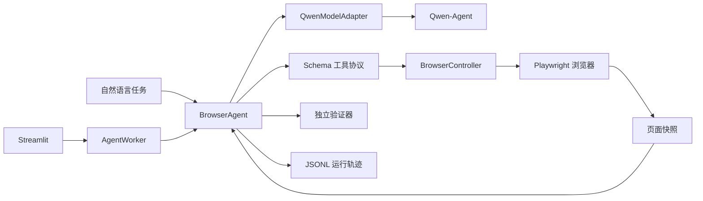

# BrowserAgent

基于 **Qwen-Agent、Playwright、Pydantic 和 Streamlit** 的浏览器自动化智能体。模型通过结构化 function calling 选择工具，Playwright 操作真实浏览器；Streamlit Worker 运行会保留可下载的事件轨迹，并由独立验证器区分“模型报告完成”和“任务验证通过”。

## 已实现能力

- 9 个 JSON Schema 工具：导航、观察、点击、填写、按键、滚动、下拉选择、提取和结束任务。
- 页面元素绑定 `snapshot_id + element_id`，页面变化后拒绝复用旧元素引用。
- 最大步数、步骤间耗时检查、无效调用次数、无进展检测和步骤间协作式取消。
- Worker 运行独立保存 JSONL 事件和结果 JSON；敏感填写内容在事件中脱敏，填写后停止截图。
- 本地课程检索、详情和报名演示站，15 条评测任务按 6 条开发集和 9 条保留集划分。
- Streamlit 执行时间线、取消按钮、执行/验证双状态和轨迹下载。

## 架构



`BrowserAgent` 负责 observe-decide-execute 循环；`BrowserController` 拥有单一 Playwright 生命周期；`QwenModelAdapter` 处理 Qwen-Agent 返回格式；`TraceWriter` 和验证器不依赖模型判断。

## 安装与运行

```powershell
python -m pip install -r requirements.txt
playwright install chromium
Copy-Item .env.example .env
streamlit run src/app/streamlit_app.py
```

在 `.env` 中填写 `DASHSCOPE_API_KEY` 后，可以运行自然语言任务：

```powershell
python -m src.demo.run_demo "打开 https://example.com 并提取页面标题" --json
```

无需 API Key 的确定性演示：

```powershell
python -m src.demo.run_demo --scripted dev-python --json
python -m evals.run --mode scripted --split all
```

## 测试与评测

```powershell
$env:PYTEST_DISABLE_PLUGIN_AUTOLOAD='1'
python -m pytest -q
python -m compileall -q src evals
```

当前脚本化基线覆盖 15 条本地任务，全部由 Playwright 在真实浏览器内执行。规则验证器分别检查最终页面证据与脚本报告，报告内容不能替代缺失的页面证据。它用于证明工具协议、页面观察、交互与验证链路可以稳定回归；因为 `model_calls=0`，不能作为 Qwen 自主规划成功率。真实模型评测可执行 `python -m evals.run --mode qwen`，结果会写入 `artifacts/`，该目录不会提交到 Git。

## 项目结构

```text
src/core/       Agent 循环、浏览器控制器、工具协议、Worker、轨迹
src/app/        Streamlit 界面
src/demo/       CLI
demo_site/      确定性本地网站
evals/          任务集、验证器和评测入口
tests/          单元测试与真实浏览器集成测试
docs/           架构方案和同类项目调研
```

同类项目对比、Qwen-Agent 与 LangGraph 的取舍见 [`docs/research/2026-09-18-browser-agent-comparison-and-proposal.md`](docs/research/2026-09-18-browser-agent-comparison-and-proposal.md)。

## 限制

- 公开网站的 DOM、登录和反自动化策略会变化，因此只作为现场演示，不计入确定性回归结果。
- 取消和耗时检查发生在模型调用与浏览器动作之间；底层同步模型请求若阻塞，需要等待请求自身的网络超时返回。
- JSONL 轨迹与下载由 `AgentWorker` 提供；直接调用 `BrowserAgent` 只返回内存结果，脚本化 CLI 另存结果 JSON。
- 涉及验证码、支付和高风险提交时，需要在产品层增加人工确认策略。
- 仓库不保存 API Key、Cookie 或本地运行产物。
