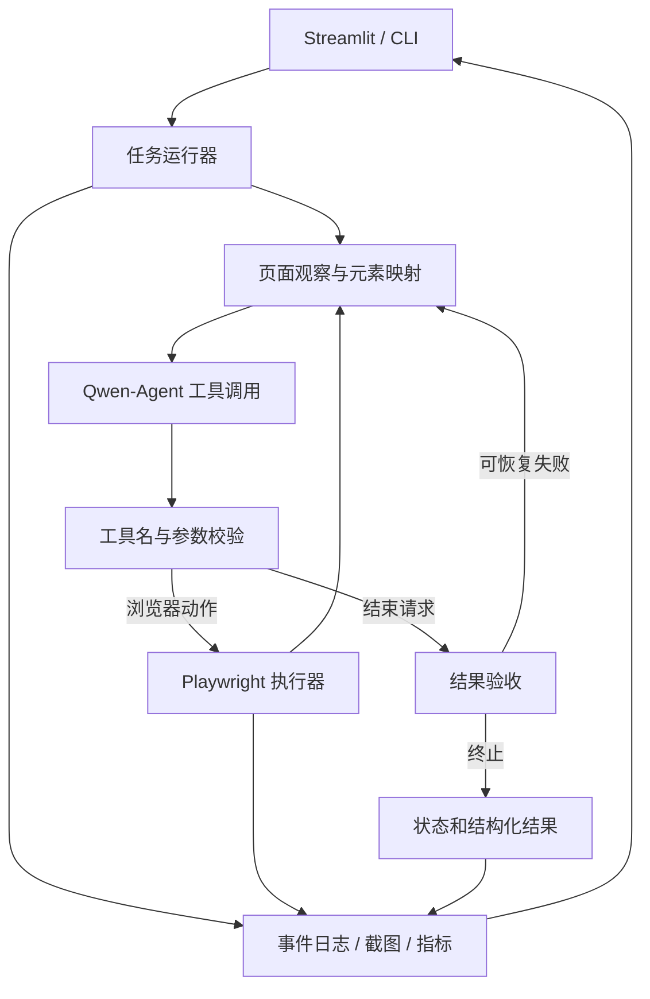

# BrowserAgent：开源项目调研与实现方案

调研日期：2026-09-18。状态：研究与设计提案，尚未实施。

目标：面向 AI 应用／Agent 开发岗位，在现有 Python / Qwen-Agent / Playwright / Streamlit 项目上，形成可演示、可解释、可复现的浏览器智能体。

## 1. 调研范围与证据口径

选择与浏览器 Agent 直接相关、GitHub 星标超过两万、2024 年以后创建且近期仍有活动的四个项目。星标和时间来自本次直接调用 GitHub REST API 的结果；技术架构来自官方仓库源码和官方文档。不是穷尽排行榜，也没有运行四个项目的同环境性能基准。

`created_at` 是仓库创建时间，不一定是首次公开发布日；`pushed_at` 是仓库推送时间，不保证是主分支代码更新时间。以下日期按 UTC 记录。星标随时间变化。

| 项目 | Stars 快照 | 仓库创建日 | 最近推送日 | 定位 | 许可证 |
| --- | ---: | --- | --- | --- | --- |
| [Browser Use](https://github.com/browser-use/browser-use) | 115,076 | 2024-10-31 | 2026-09-15 | 自主浏览器 Agent | MIT |
| [Stagehand](https://github.com/browserbase/stagehand) | 24,329 | 2024-03-24 | 2026-09-18 | 面向 Agent 的浏览器 SDK | MIT |
| [Skyvern](https://github.com/Skyvern-AI/skyvern) | 23,024 | 2024-02-28 | 2026-09-18 | 浏览器任务与工作流平台 | AGPL-3.0 |
| [Playwright MCP](https://github.com/microsoft/playwright-mcp) | 37,235 | 2025-03-21 | 2026-09-17 | 提供浏览器工具的 MCP 服务 | Apache-2.0 |

元数据原始接口：[Browser Use](https://api.github.com/repos/browser-use/browser-use)、[Stagehand](https://api.github.com/repos/browserbase/stagehand)、[Skyvern](https://api.github.com/repos/Skyvern-AI/skyvern)、[Playwright MCP](https://api.github.com/repos/microsoft/playwright-mcp)。本次查询四个仓库的 `archived` 均为 `false`。

## 2. 功能、架构与技术栈比较

### 2.1 Browser Use：最接近项目目标的自主 Agent

- 功能：接收任务，获取浏览器观察，循环选择与执行动作，并保留执行历史；源码还包含失败上限和循环检测。
- 架构：Agent 编排 → 动作工具 → BrowserSession；DOM 服务构建页面观察，浏览器会话通过事件总线协调浏览器操作。
- 当前技术栈：Python、Pydantic、`cdp-use`、`bubus` 和多模型适配。当前 `pyproject.toml` 标注版本 0.13.10；核心已经直接使用 CDP，不能沿用旧文章的“Playwright 封装”描述。

依据：[依赖与版本](https://github.com/browser-use/browser-use/blob/main/pyproject.toml)、[BrowserSession 源码](https://github.com/browser-use/browser-use/blob/main/browser_use/browser/session.py)、[Agent 源码](https://github.com/browser-use/browser-use/blob/main/browser_use/agent/service.py)、[DOM 服务](https://github.com/browser-use/browser-use/blob/main/browser_use/dom/service.py)。

工程判断：优势是 Agent 主循环和浏览器状态管理完整，最值得研究其观察、动作、错误反馈之间的边界；代价是事件驱动会话和 CDP 层增加阅读及维护成本。直接把它作为本项目的核心执行器会把主要能力交给上游，个人贡献需要围绕额外的评测或业务能力体现。

本项目借鉴：每步重新观察、类型化动作、有限恢复和执行历史。暂不复制其 CDP 驱动及大规模事件系统。

### 2.2 Stagehand：AI 操作与确定性代码的组合

- 功能：`act` 执行自然语言动作，`observe` 寻找操作目标，`extract` 按 schema 提取数据；还能调用普通浏览器 API。
- 架构：上层应用或外部 Agent 控制流程；SDK 提供 AI 原语与浏览器驱动。当前 v4 使用浏览器旁的运行时与 CDP，提供 TypeScript、Python、Go SDK，不依赖 Playwright/Puppeteer。
- 关键版本变化：v4 已移除内置 `agent()`，用户自行维护工具循环或执行生成的脚本。不能把 v3 的内置 Agent 当作当前 v4 功能。

依据：[v4 介绍](https://docs.stagehand.dev/v4/first-steps/introduction)、[v3 → v4 迁移说明](https://docs.stagehand.dev/v4/migrations/v3)、[当前仓库](https://github.com/browserbase/stagehand)。本次主分支提交快照为 `574ecdd051dc5305254b40e480b147dd28845003`。

工程判断：优势是自然语言操作与确定性代码的职责明确，提取结果有类型约束；边界是 v4 不负责完整自主任务编排。部分托管能力不能当作本地开源能力：例如官方当前缓存文档明确要求 Browserbase 浏览器及 API key，本地 `cache` 不生效。[缓存说明](https://docs.stagehand.dev/v4/best-practices/caching)

本项目借鉴：把观察、动作执行和结构化提取拆开；已知目标由程序确定性执行；模型负责需要语义判断的部分。

### 2.3 Skyvern：可追踪的任务与工作流

- 功能：通过模型和视觉完成浏览器任务，提供任务组合、工作流构建以及 SDK／API。
- 架构：任务／工作流层 → Agent 与动作层 → 浏览器执行，另有服务端、数据库和 Web UI 支持运行管理。
- 当前技术栈：Python、Playwright、FastAPI、LiteLLM、SQLAlchemy，以及 TypeScript 前端。部署方式需区分：本地快速启动可使用 SQLite，Compose 路径包含 PostgreSQL；不是所有用法都必须部署完整平台。

依据：[官方 README](https://github.com/Skyvern-AI/skyvern)、[Python 依赖](https://github.com/Skyvern-AI/skyvern/blob/main/pyproject.toml)、[Compose 配置](https://github.com/Skyvern-AI/skyvern/blob/main/docker-compose.yml)。

工程判断：优势是将任务、步骤、运行记录和工作流组织成产品，适合研究失败排查与结果追踪；相对本项目，服务端、持久化、前端和视觉推理会增加开发部署范围。官方将部分反自动化能力归入托管云，不能把云端能力一并视为本地开源功能。许可证为 AGPL-3.0，本文仅借鉴设计，不计划复制其源码。[仓库功能与许可证说明](https://github.com/Skyvern-AI/skyvern)

本项目借鉴：独立 run_id、步骤记录、截图、状态分类和验收证据，先用文件存储实现。

### 2.4 Playwright MCP：清晰的浏览器工具边界

- 功能：通过 MCP 暴露导航、点击、输入、页面快照等工具；核心观察路径是结构化可访问性快照，不要求视觉模型。
- 架构：外部 LLM／Agent → MCP 客户端 → 浏览器工具服务 → Playwright。它提供工具，不自行理解并完成整个用户任务。
- 技术栈：Node.js、TypeScript、MCP 和 Playwright。当前包入口已把 `createConnection` 委托给 `playwright-core`，分析实现时不能只看此仓库的薄入口。

依据：[官方说明与工具参数](https://github.com/microsoft/playwright-mcp)、[package.json](https://github.com/microsoft/playwright-mcp/blob/main/package.json)、[入口源码](https://github.com/microsoft/playwright-mcp/blob/main/index.js)。本次主分支提交快照为 `ea43eee0d95196ab31f7619b26f78d7b9c664286`。

工程判断：优势是结构化观察与工具接口容易被不同 Agent 复用；不足是任务规划、结束条件和验收仍需上层实现。文本快照路线对缺少语义结构的纯视觉界面有边界，这是观察方式带来的推断，不是本次实测结论。MCP 协议本身也不会自动提高任务成功率。

本项目借鉴：目标来自页面观察、工具参数有 schema、浏览器会话有明确生命周期。本阶段用 Python 内部工具接口实现；有真实跨应用复用需求时再添加 MCP 服务层。

## 3. 选型结论

建议采用“Browser Use 的循环组织方式 + Stagehand 的职责划分 + Playwright MCP 的观察与工具边界 + Skyvern 的运行记录”。这是设计借鉴，不是同时安装四个框架。

| 实现路线 | 优点 | 对本项目的代价 | 选择 |
| --- | --- | --- | --- |
| 直接封装 Browser Use | 快速获得完整浏览器 Agent | 核心逻辑来自上游；会改变现有实现和简历贡献重点 | 可用于后续外部基线 |
| Qwen-Agent + 自研受控循环 + Playwright | 沿用当前代码；定位、恢复、验收都能解释 | 必须为工具和状态管理补测试 | 推荐主线 |
| 完整工作流平台 + 双框架 + 视觉 | 可拓展能力多 | 同时增加服务、编排和模型复杂度 | 分期扩展 |

推荐技术栈：Python 3.12、Qwen-Agent、Playwright、Pydantic、Streamlit、pytest。真实模型使用可配置的 Qwen 模型；具体模型 ID、依赖版本和浏览器版本在实现第一阶段验证后锁定，避免把上游主分支 alpha 版本直接写入依赖。

## 4. 相对原设计的关键修订

此提案细化并修订 `docs/superpowers/specs/2026-09-18-browser-agent-engineering-design.md`，后续实现应先合并这些决策；原文尚未按本次研究自动改写。

1. **工具协议：**主路径采用 Qwen-Agent 的 `functions`／`function_call` 接口，并验证参数。手写 JSON 动作可留作对照模式，不再作为默认路径。Qwen-Agent 官方已有完整示例，但这不等于保证模型服务端强制 JSON 合法，仍需本地校验。[官方工具调用示例](https://github.com/QwenLM/Qwen-Agent/blob/main/examples/function_calling.py)
2. **成功语义：**模型结束与验收通过分开保存，不能用同一个 `success` 混淆二者。
3. **运行方式：**浏览器对象及事件循环归属单个任务 worker，界面只读取事件，避免跨线程访问页面和反复切换 loop。
4. **验收机制：**先设计测试站点与确定性验收器，再报告成功率；预留测试任务，避免所有任务都被提示词调试使用。
5. **改造范围：**保留 `src/core` 主结构，按职责增添小模块，不为了目录整齐一次性迁移全部文件。

## 5. 目标功能与示范任务

项目定位：支持中文自然语言指令、结构化信息提取和执行复盘的浏览器 Agent。

完整演示示例：

> 在本地课程网站中，查找适合初学者的 Python 课程，筛选课时不超过 20 小时的项目，打开详情页提取名称、课时和链接，将选定课程及报名信息填入测试表单，最后核验提交结果。

本地站点只有测试数据，无真实报名副作用。该任务可以串起语义理解、搜索、条件选择、多步导航、信息提取、表单操作与验收。另准备公开网站只读信息检索演示，用于展示实际网页适应情况；其结果与本地评测分开报告。

## 6. 架构与数据流

只有一个模型决策循环；验收默认由程序完成。没有必要为“规划、执行、反思”分别引入三个 Agent。

### 6.1 页面观察

`Observation` 包含 `snapshot_id`、`page_id`、URL、标题、经过预算裁剪的正文和元素列表。元素包含 `element_id`、角色、标签、文本、关联 label、placeholder、可编辑与禁用状态。

观察模块维护真实节点引用与元素标识的映射。操作必须携带当前快照标识；执行前验证元素仍与引用一致，失效则返回 `stale_element` 并重新观察。不得分别枚举按钮和输入框生成不一致编号。不要把一份快照中的编号跨导航复用。

正文和元素列表采用可配置预算，并保留查询／分页观察入口，让目标在列表后部时仍可找到。第一页只保留前 30 个元素不能作为通用查找方案。首版限定顶层 DOM 和原生表单；iframe、closed Shadow DOM、canvas 等作为明确边界。

### 6.2 工具与模型接口

工具集合：`navigate`、`observe`、`click`、`fill`、`press_key`、`scroll`、`select_option`、`extract`、`finish`。

模型适配器用 Qwen-Agent 的标准工具调用形式传递工具 schema，接收结构化调用。工具注册表和参数模型是 schema 的唯一来源，运行器禁止未知工具，避免提示词与执行器的参数格式漂移。

每轮执行一个会改变页面的工具，随后重新观察。若模型返回多个依赖同一旧快照的动作，拒绝多动作批次并反馈重新决策，不能悄悄丢弃调用或用旧编号连续操作。

`extract` 按预定义业务 schema 生成结果，并保留 URL 与支持字段的页面原文片段。Pydantic 只保证数据形状；字段是否正确还需验收器判断。

Qwen-Agent 官方示例将 `stream=False` 的返回值直接作为消息列表；当前 `agent.py` 以流式方式迭代该返回值，实施时应纳入适配器契约测试，结合实际安装版本修复。[非流式返回示例](https://github.com/QwenLM/Qwen-Agent/blob/main/examples/function_calling.py)

### 6.3 浏览器执行

使用 Playwright 的 `locator.click()`、`fill()`、`select_option()` 等操作，由其处理相关可操作性等待；不再用拼接 JavaScript 修改 `el.value` 作为主要输入方式。[自动等待与可操作性检查](https://playwright.dev/python/docs/actionability)

浏览器启动、观察、操作、验收、关闭在同一任务生命周期内完成。Windows 下使用支持子进程的事件循环，并通过本地集成测试确认。任务 worker 拥有浏览器；Streamlit 主线程只投递任务、读取队列和设置取消信号。停止请求在可中断边界处理，网络与浏览器调用有超时；取消时不宣称可以立即中止所有远端模型请求。

### 6.4 状态、恢复与结果核验

执行状态：`queued / running / completed / failed / cancelled / max_steps_exceeded / timed_out`。

验收状态独立保存：`passed / failed / not_checked`。`completed` 只代表模型声明结束；评测计分使用确定性验收结果。开放任务若无法客观核验，界面显示“已结束，未自动验收”，不显示“已验证成功”。

初始默认预算（可配置）：最大 20 步、总时限 180 秒、单次工具超时 10 秒、导航超时 30 秒、连续无效工具调用最多 2 次、同一状态下连续无进展 3 次终止。预算是设计初值，不是实测最优值。

恢复策略：

- 元素失效：重新观察，再请求模型决定；不猜测新的目标。
- 参数非法：反馈缺少／错误字段及 schema；达到上限则终止。
- 页面超时：保留可获取的实际页面状态，区分导航失败与部分加载。
- 点击可能已生效但返回超时：先检查后置状态，避免盲目重复提交。
- 页面与动作连续不变：以无进展原因结束。
- 初始化异常、用户取消、失败、成功均走资源清理路径。

### 6.5 可观测与界面

每个任务生成独立 `run_id`，保存 `events.jsonl`、`result.json`、截图；截图文件按运行隔离，解决当前不同任务 `step_01.png` 相互覆盖的问题。

事件包含阶段、工具名、参数、执行结果、错误码、耗时及当前 URL。模型 token usage 如接口可获取则记录，否则明确为空，不能当作零；字符数仅用作观察体积指标，不冒充 token 数。

Streamlit 提供任务输入、配置、预设任务、状态、步骤列表、截图预览、停止按钮与轨迹下载。可用 `st.fragment(run_every=...)` 轮询事件；依赖版本需锁定并测试，不要求 worker 调用 Streamlit UI API。[fragment 文档](https://docs.streamlit.io/develop/api-reference/execution-flow/st.fragment)

日志保存允许字段，屏蔽 API key、密码输入值和认证配置。页面正文视为待处理数据，不能覆盖任务或扩大工具权限。

## 7. 文件改动地图

| 文件 | 责任 |
| --- | --- |
| `src/core/agent.py` | 保留入口；改为受控的观察—决策—执行循环 |
| `src/core/model_adapter.py` | Qwen-Agent 调用、消息形状归一化、工具调用与 usage |
| `src/core/schemas.py` | Observation、ToolCall、ToolResult、RunResult |
| `src/core/tools.py` | 工具注册、schema 和参数校验 |
| `src/core/browser_controller.py` | 生命周期、Playwright 确定性操作 |
| `src/core/observer.py` | 元素引用、语义提取、正文与元素预算 |
| `src/core/trace.py` | 事件与运行产物序列化、敏感字段过滤 |
| `src/core/worker.py` | 单任务 worker、队列、取消与清理 |
| `src/core/config.py` | 模型、预算、产物位置配置 |
| `src/app/streamlit_app.py` | 实时轨迹、结果、取消和导出 |
| `src/demo/run_demo.py` | CLI 与现有入口兼容 |
| `demo_site/` | 搜索、详情、表单和受控异常演示 |
| `evals/tasks.json`、`evals/run.py`、`evals/verifiers.py` | 固定任务与评测 |
| `tests/` | 模型契约、工具、浏览器与场景回归测试 |

## 8. 分阶段实现与验收

### 阶段 A：可复现基线与接口确认

- 固定原始代码 commit、Python 和依赖版本，记录当前失败案例。
- 核验实际安装 Qwen-Agent 的流式／非流式返回形状及工具调用路径。
- 建立本地测试页面，覆盖混合链接／按钮／输入框、中文和特殊字符输入、元素重排。
- 先保存原始基线；另定义“修复阻断问题后的基线”，用于后续能力消融。

验收：使用脚本化模型与真实本地浏览器能够重现已知定位问题；不需要真实模型调用。

### 阶段 B：浏览器工具与页面观察

- 补齐点击，修复输入定位和正文反馈。
- 实现元素引用、快照有效性验证及标准操作结果。
- 建立浏览器生命周期与超时处理，测试资源关闭。

验收：工具集成测试覆盖导航、点击、输入、回车、滚动、下拉选择；DOM 重排后不会误操作其他字段；旧快照操作产生明确错误。

### 阶段 C：Qwen 工具调用与受控循环

- 引入参数模型与 Qwen 适配器，去掉默认正则动作协议。
- 完成错误反馈、无进展检测、预算和终止状态。
- 分离模型结束和结果验收，保留正确的工具消息历史。

验收：假模型覆盖成功、非法参数、过期元素、模型异常、循环无进展与步数耗尽；真实 Qwen 冒烟测试走通搜索—详情—结果输出。

### 阶段 D：轨迹、界面与演示

- 接入事件队列、截图、停止操作和 JSON 导出。
- 增加预设演示任务，展示可核验的结果字段及来源。
- 为每个运行隔离产物，避免覆盖和跨会话串数据。

验收：界面在执行中持续更新；连续运行两个任务不会重复执行或覆盖记录；取消后浏览器在超时边界内被关闭。

### 阶段 E：评测与简历材料

- 冻结任务、验收器、模型配置、提示词及代码版本。
- 执行重复实验、错误分类与改造对照。
- 输出 README、架构图、演示录屏、指标表及基于证据的简历描述。

验收：报告可追溯到每次运行；不填写未测得的提升比例；明确本地任务结果与公开网页案例的区别。

## 9. 评测设计

任务集先采用 15 个本地任务：检索提取、多步导航、表单交互各 5 个。指定其中 6 个开发任务、9 个保留测试任务；测试任务在冻结提示词之后评测，不用于事前调优。若后续用失败案例调试，应说明测试集已被使用并新增保留任务。

每种配置每个任务运行 3 次；全套为 45 次运行，其中保留测试集为 27 次。小样本报告分子／分母、任务分项和重复运行结果，不外推为通用互联网成功率。

验收条件：

- 提取：返回字段与站点真实数据一致，链接确实来自目标记录。
- 导航：到达指定详情并提取必要字段；仅匹配 URL 不能证明任务全完成。
- 表单：检查提交后的字段与站点接收记录，不仅检查页面出现“成功”字样。
- 异常恢复：在相同任务上施加可控元素变更、延迟或无效响应，记录是否恢复。

指标：任务通过数／总数、首次与重复运行通过率、成功任务平均步数、全体运行平均与 P95 耗时、模型调用次数、可获取的 token usage、失败类型。结构校验通过率作为辅助指标，不能替代任务成功率。

比较分三种，结论不得混用：

1. **修复前后：**原始版本与工程增强版，展示可运行性的改善；明确包含 bug 修复。
2. **能力消融：**以修复阻断问题后的版本为共同基础，分别关闭恢复机制、上下文裁剪等能力，其他条件一致。
3. **外部基线：**后续若加入 Browser Use，固定可比模型、任务、浏览器状态和预算，单独注明模型适配及工具差异。本次不声称优于这些开源项目。

## 10. LangGraph 的安排

LangGraph 是状态化编排运行时，可支持持久化、流式和人工介入，并可独立于 LangChain 使用；它与 Qwen-Agent 的模型／工具接口并非简单的二选一。[官方架构说明](https://docs.langchain.com/oss/python/langgraph/overview)

主版本稳定后，可增加 `observe → decide → execute → verify` 的 LangGraph 编排适配器，共享浏览器工具、Qwen 模型适配器、提示词和验收器。对比对象应准确写为“Qwen-Agent 工具调用驱动的自定义循环”与“LangGraph 显式状态图编排”。

优先比较状态表达、失败恢复实现、可观测和暂停恢复的工程差异。相同模型和工具下，不能预设更换编排框架就提高推理能力。图状态持久化也不意味着已关闭的浏览器 DOM 引用可以直接恢复，恢复后必须重新观察。

若没有完成这一步，简历写“调研对比”；完成同条件实现和记录后才写“实现并评测”。

## 11. 建议形成的简历贡献

完成并通过验收后，可围绕以下真实贡献组织简历：

1. 基于 Qwen-Agent 工具调用与 Playwright 构建中文自然语言浏览器 Agent，实现页面观察、工具执行和反馈闭环。
2. 设计快照绑定的元素定位与结构化参数校验，加入受控恢复、无进展检测及执行预算。
3. 基于 Streamlit 实现运行轨迹、截图、状态和结果导出，支持任务复盘。
4. 构建确定性浏览器任务集与独立验收器，报告实际成功率、执行步数和耗时。

目前这些是交付目标，不能写成已完成。优先实现阶段 A 至 E，再决定是否增加 LangGraph 或视觉能力。
